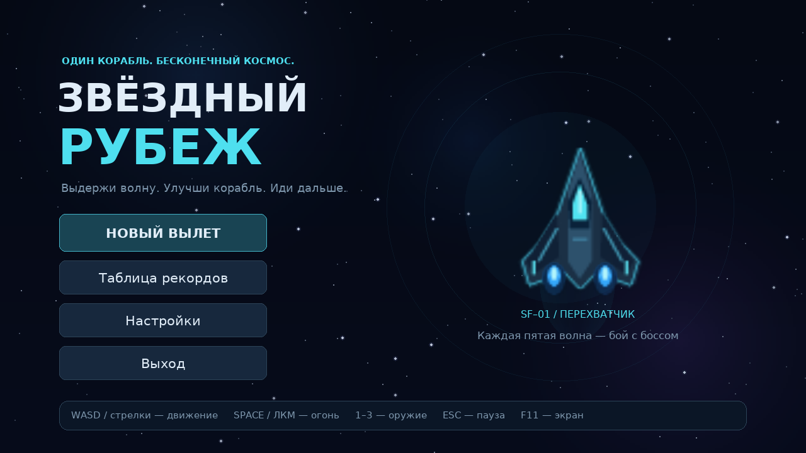

# Звёздный рубеж

Однопользовательский космический шутер на Python и Pygame. Управляйте кораблём,
переживайте волны, собирайте кредиты и улучшайте оборудование. Каждая пятая
волна — встреча с боссом; после победы забег продолжается. Очки записываются
в таблицу рекордов, а покупки расходуют только кредиты.



Проект предназначен для курсовой работы по алгоритмизации и программированию:
в нём есть наследование, State Pattern, векторы, прогнозирование столкновений,
группы спрайтов, кеширование ресурсов, SQLite и автоматические тесты.

## Установка и запуск

Нужен **Python 3.11 или новее**. Единственная внешняя зависимость —
**Pygame 2.6.1**; SQLite входит в Python. Ресурсы уже включены в проект.
Административные права не нужны. Интернет нужен для первоначальной установки
Pygame; затем игра работает без сети.

Windows: установите Python с [python.org](https://www.python.org/downloads/),
распакуйте проект и запустите **`launch_windows.bat`**. Он создаст `.venv`
рядом с игрой, установит зависимость при первом запуске и откроет игру.
Сообщения скрипта на английском, чтобы избежать проблем кодировки CMD.
При отсутствии интернета на первом запуске предварительно установите Pygame
в эту `.venv` из локального wheel-файла.

Ручная установка на Windows, из папки проекта:

```bat
py -3 -m venv .venv
.venv\Scripts\python.exe -m pip install -r requirements.txt
.venv\Scripts\python.exe main.py
```

Linux / macOS:

```bash
python3 -m venv .venv
source .venv/bin/activate
python -m pip install -r requirements.txt
python main.py
```

На некоторых Linux-дистрибутивах модуль `venv` поставляется отдельным пакетом.
Если создавать виртуальную среду нельзя, Pygame можно установить в уже
подготовленную пользовательскую среду Python.

При активированной среде стандартная команда запуска — **`python main.py`**.
Можно запускать и из другой рабочей папки, передав полный путь к `main.py`:
ресурсы определяются относительно файлов проекта.

Графическая игра требует рабочего стола с доступным дисплеем. Облачная среда
без дисплея позволяет проверять логику и сохранять снимки, но не заменяет
интерактивную игру. Если аудиоустройство недоступно, игра продолжит работу
без звука.

## Управление

| Клавиши / кнопка | Действие |
| --- | --- |
| WASD или стрелки | Движение; диагональ не ускоряет корабль |
| Space или левая кнопка мыши | Стрельба при удержании |
| 1 | Лазер |
| 2 | Ракеты, после покупки |
| 3 | Плазма, после покупки |
| Esc | Пауза, возобновление или возврат из дополнительного экрана |
| F11 | Оконный / полноэкранный режим |

При потере фокуса во время боя игра автоматически ставится на паузу.
Окно можно изменять: пропорции 1280×720 сохраняются, при необходимости
добавляются чёрные поля. Кнопки учитывают масштаб окна и положение этих полей.

## Как играть

Первая волна знакомит с разведчиками. Со второй появляются стрелки,
с третьей — перехватчики, с четвёртой — тяжёлые корабли. Оранжевые линии
предупреждают о выстрелах; отметки сверху показывают места появления объектов.
Разведчики двигаются по синусоиде, стрелки целятся в положение корабля,
перехватчики реагируют на приближающиеся выстрелы, тяжёлые стреляют веером.
Босс чередует три атаки и ускоряется при потере половины здоровья.
Между его снарядами остаются проходы.

| Оружие | Базовые свойства | Когда полезно |
| --- | --- | --- |
| Лазер | 11 урона, интервал 0,19 с, скорость 850 пикселей/с | Быстрые одиночные цели и точная стрельба |
| Ракета | 42 урона, интервал 0,95 с, взрыв радиусом 82 пикселя | Скопления целей и тяжёлые корабли |
| Плазма | 23 урона, интервал 0,49 с, до трёх разных целей | Цели, выстроенные вдоль траектории |

Улучшения повышают урон и сокращают перезарядку всех видов оружия.
Переключение сохраняет текущую перезарядку. Боеприпасы не ограничены;
разница оружия определяется скоростью, уроном, частотой стрельбы и формой атаки.

Крупные и средние метеориты распадаются на 2–3 меньших: после взрыва
не стойте на месте. Корабль получает короткую неуязвимость после повреждения.
Здоровье и щит показаны отдельно: щит принимает урон первым и начинает
восстанавливаться через 3,5 секунды без нового повреждения.

Волна заканчивается, когда все запланированные враги и метеориты уничтожены
или покинули активную область, включая фрагменты. Затем открывается магазин.
Можно улучшать скорость, частоту огня, урон, корпус и щит, ремонтироваться,
открывать ракеты и плазму. Для улучшений показаны цена, уровень и новое значение;
цены растут, максимальный уровень — 5. Недоступные покупки отключены.
Нажмите кнопку следующей волны, когда закончите покупки.

Здоровье, кредиты и оборудование сохраняются между волнами текущего забега.
Новый забег начинается с исходного корабля. После проигрыша введите имя:
пустое имя заменяется на «Пилот». Один забег записывается только один раз.
Десять лучших результатов доступны из главного меню.

## Настройки и сохранения

В настройках меняются громкость музыки и эффектов, дрожание камеры,
количество частиц и полноэкранный режим. Изменения применяются сразу
и сохраняются между запусками. Повреждённый JSON возвращает безопасные значения.

Игра создаёт `settings.json` и `leaderboard.sqlite3` в пользовательской папке:

| Система | Папка по умолчанию |
| --- | --- |
| Windows | `%LOCALAPPDATA%\StarFrontier` |
| Linux | `$XDG_DATA_HOME/StarFrontier`, обычно `~/.local/share/StarFrontier` |
| macOS | `~/Library/Application Support/StarFrontier` |

Для переноса сохранений или запуска в изолированной среде задайте переменную
**`STAR_FRONTIER_DATA_DIR`** с путём к доступной для записи папке.
В Windows CMD: `set "STAR_FRONTIER_DATA_DIR=C:\Users\User\StarFrontierData"`.
В Linux / macOS: `export STAR_FRONTIER_DATA_DIR="$HOME/StarFrontierData"`.
Эта настройка влияет на оба файла и не требует менять исходный код.
Сам забег между запусками не сохраняется: база хранит только итоговые рекорды.

## Проверки

Из корня проекта с установленными зависимостями:

```bash
python -m unittest discover -s tests -v
python main.py --headless --frames 60 --screenshot artifacts/menu.png
python tools/smoke_gameplay.py
```

`--headless` включает dummy-драйверы SDL для видео и звука, `--frames`
ограничивает число кадров, `--screenshot` сохраняет последний логический кадр.
Без ограничения кадров headless-приложение остаётся в основном цикле.
Обычный запуск с рабочим дисплеем не требует этих параметров.
`tools/smoke_gameplay.py` проводит воспроизводимый бой скриптовым пилотом:
шесть волн, покупки, победа над боссом и продолжение забега.

Тесты проверяют ключевую логику: покупки и пределы улучшений, запись рекордов
во временную SQLite, завершение волн, деление метеоритов и игровые переходы.
Фактически проведённые проверки, результаты и ограничения среды описаны
в [docs/VALIDATION.md](docs/VALIDATION.md).

## Файлы проекта и защита

```text
main.py                 точка входа и параметры проверочного запуска
game.py                 окно, главный цикл, масштабирование и состояния
settings.py             константы логического мира
states/                 меню, бой, пауза, магазин, результаты и настройки
entities/               корабли, снаряды, метеориты, бонусы
systems/                ресурсы, звук, волны, частицы, покупки, SQLite
ui/                     кнопки и индикаторы
assets/                 готовые PNG, WAV и шрифты с кириллицей
tools/                  генератор ресурсов и функциональный прогон боя
tests/                  содержательные автоматические проверки
docs/                   архитектура и результаты проверки
launch_windows.bat      удобный запуск на Windows
```

Краткое объяснение классов и алгоритмов для защиты:
[docs/ARCHITECTURE.md](docs/ARCHITECTURE.md). Код снабжён русскими комментариями
в местах, где важно объяснить причину решения. Ресурсы уже подготовлены;
`python tools/generate_assets.py` нужен только при намеренном пересоздании.

Переносимый ZIP с кодом и ресурсами можно повторно собрать командой
`python tools/build_zip.py путь/к/star-frontier.zip`; кеши, Git и сохранения
в архив не включаются.

Исходники, оригинальные изображения и аудио распространяются по
[MIT License](LICENSE). Шрифты DejaVu имеют отдельную свободную лицензию:
[assets/fonts/LICENSE-DejaVu.txt](assets/fonts/LICENSE-DejaVu.txt).
